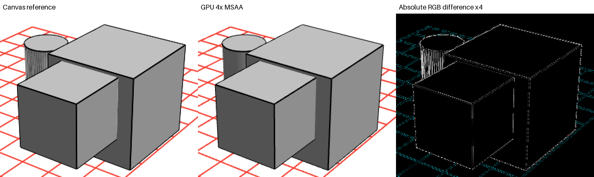
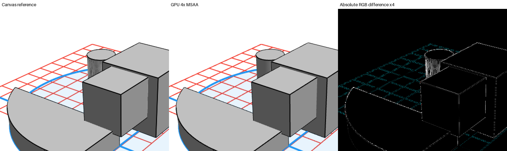
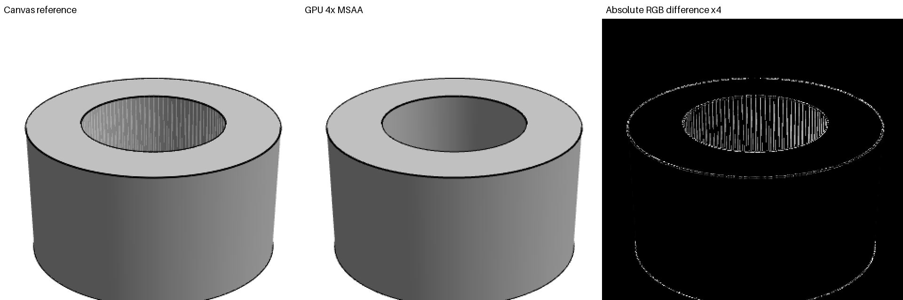
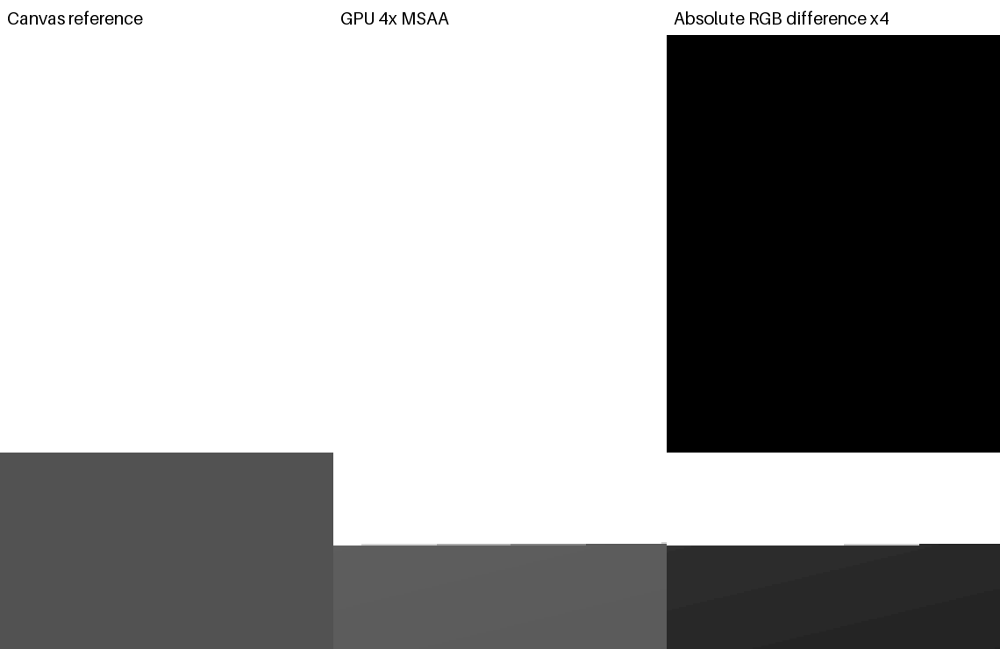

# Experimental GPU depth viewport

**Recommendation: retain Canvas. Stable 60 FPS with current visual quality has
not been demonstrated.** Bodies and CAD edges render on Flutter GPU, but the
installed SDK's image surface exhausts a small texture budget during warmup.
Image parity also fails. This is a reproducible negative feasibility result,
not a completed renderer migration.

## Opt in

```sh
python3 tool/build_gpu_shaders.py
flutter run -d macos --enable-impeller --enable-flutter-gpu \
  --dart-define=CAD_RENDER_BACKEND=flutter-gpu
```

Alternatively pass `backend: CadRenderBackend.flutterGpu` to a shaded `CadScene`.
The ordinary default remains Canvas; wireframe keeps its existing path.
`CAD_RENDER_BACKEND=canvas` explicitly selects the reference. No engine fork, SDK
modification, native render bridge, or default-renderer algorithm change is
included. Regenerate the committed shader bundle after shader or SDK changes.

On the tested SDK the viewport can stop after as few as eight distinct camera images and
displays a diagnostic. Controls remain usable. It never keeps presenting an old
camera image while claiming a successful GPU frame rate. Select Canvas for normal
editing, or remount the viewport to repeat the experiment.

## Installed SDK and feasibility

Tested: Flutter **3.47.5**, Dart **3.13.4**, framework `6a19cca564`, engine revision
`af7e796e16`, content hash `ab598368592da0064197e2bc15c7f5b0a2c6bb1f`, Apple M1,
macOS 26.6.2. The authoritative API inspected was the actual downloaded package
at `$FLUTTER_ROOT/bin/cache/pkg/flutter_gpu`, the installed `impellerc`, and the
installed FlutterMacOS framework headers. Online documentation was supplementary.

Native tests confirm indexed persistent buffers, uniform overwrite/flush,
float32 depth/stencil attachments, depth writes/comparisons, two-sided drawing,
4x offscreen MSAA/resolve, asynchronous command completion, and
`GpuImageSurface.currentImage` presentation as a Flutter image. This prototype
requires macOS Impeller, `d32FloatS8UInt` depth and offscreen MSAA; other targets
are explicitly unsupported.

The ownership limitation is material. Buffers, textures, render passes and
command buffers have native finalizers but no deterministic destruction API.
`GpuImageSurface.acquireNextFrame` can allocate when native references prevent
reuse. It offers neither a pool maximum nor a non-allocating acquire. The
installed C++ `Surface::IsReusable` tests native reference counts; transient
wrappers can retain those references until Dart finalization. Our native probe
observed one additional color texture per completed camera submission.

This matches the independently reported
[Flutter GPU image-surface issue #193775](https://github.com/flutter/flutter/issues/193775).
Our conclusion comes from the installed SDK and local probe. Eight frames do not
prove a permanent leak, but they fail the required deterministic resource budget.
Forced GC during rendering or an unfenced texture ring would obscure the problem.

The installed shader compiler also aborts on `noperspective` interpolants while
building the bundle. Interpolating `(color*w,w)` and dividing in the fragment
shader preserves screen-linear colors without that qualifier.

## Pipeline and resource ownership

`GpuSceneMesh` consumes existing tessellated triangles and analytic normals. It
uploads world positions, face IDs and indices once per scene identity/revision.
It uses only `TessellatedScene.shadedEdges`, deduplicating shared topological
boundaries. Tessellation diagonals and cylinder seams are not outlines. Bodies
use one indexed GPU draw; CAD boundary and standalone/grid strokes use one quad
draw. The fixtures therefore require **two GPU draw submissions** per camera
image, followed by one Flutter image draw.

World positions and camera translation use high/low float pairs. Camera movement
primarily overwrites a reusable **64-byte uniform buffer** containing translation,
rotation, viewport, focal length and DPR. Selection overwrites attributes;
planar selection tint matches Canvas, including its current lack of curved-face
tint. No CPU model evaluation or projection/edge visibility pass is added to
camera movement. Existing sketch overlays retain their CPU painter and solid
occlusion masks, with their cost included in profiling.

Projection preserves **+Y forward**, logical-pixel focal length/framing and the
reference `1e-6` near plane. Infinite reverse Z uses clip `z=near, w=cameraY`, clear
depth zero and `greaterEqual`. Float32 reverse depth avoids conventional far-plane
cancellation. Bodies write depth. Edges are clipped before perspective division,
expanded to one logical pixel with butt caps, and depth tested without depth
writes. A `2^-20` relative reverse-depth bias (about 8-16 float32 ULPs) avoids a constant offset that
would expose distant hidden lines. Culling is disabled. Lighting preserves the
camera-fixed light, rounded intensities and screen-linear interpolation; facing
is tested before camera rotation to reduce near-eye cancellation.

Both silhouettes and strokes use 4x MSAA. This does **not** reproduce Canvas's
coverage; shader stroke coverage remains future work. High/low coordinates
improve translation precision, but native float clipping at extreme `1e-6`
crossings still diverges significantly from CPU double-precision clipping. This
depth strategy has not passed the close-view quality gate.

There is at most **one producer command in flight**, one scene's geometry, one
uniform buffer and one size-specific MSAA/depth pair. Busy paints use the current
camera's Canvas renderer to keep sketch overlays aligned, increment `busyPaints`,
and do not count as GPU camera submissions/completions. This fallback cost is
included in frame timings. Identical camera states do not resubmit. Resizing or a
DPR change recreates attachments after producer completion. Admission stops
before a ninth admitted color texture allocation, conservatively counting prior
sizes for the viewport's whole lifetime. Stops and disposal drop viewport-owned
resource/mesh references; commands retain their own in-flight resources.

Native destruction still relies on SDK finalizers, including after rapid model
replacement or resizing. Deterministic native reclamation is therefore **not
claimed**. Diagnostic arrays are bounded integer sequences/times, not retained
camera objects, images or projected frames. Submit-to-callback time includes
Dart callback dispatch; it is neither hardware GPU execution time nor
camera-to-present latency. This image-surface API exposes no display-present
fence.

## Quality results

The matrix compares the current Canvas renderer and GPU in the same native
process: default/partial-extrusion fixtures, nine original orbit views, pan,
cursor zoom, camera-inside, an explicit near crossing, selection, two viewport
dimensions and DPR **1 / 1.5 / 2**. A hollow tube adds annular caps, a bore and
inward-facing walls. Default bodies intersect. Partial images include the
original sketch painter, aligned to the same camera and solid occluders.

All **126** cases are in
[`image_statistics_macos.json`](performance/gpu_depth/image_statistics_macos.json).
The diagnostic parity gate requires maximum RGB channel difference <=4 and fewer
than 0.5% changed pixels: **0/126 pass**. Existing reference image tests and
tolerances are unchanged. A green native test means captures, opacity, resource
assertions and controls worked; parity failure remains explicitly recorded.

| Fixture | Cases | Max channel delta | Max RGB RMSE | Max changed pixels |
| --- | ---: | ---: | ---: | ---: |
| Default | 42 | 181 | 47.523 | 38.453% |
| Partial extrusion | 42 | 181 | 47.523 | 38.453% |
| Hollow tube | 42 | 163 | 3.424 | 36.005% |

Aggregate maxima include extreme crossings. Per-case statistics separate them
from ordinary orbit views. Some curved-cell resolve seams disappear in the GPU
image, but red-line coverage, silhouettes and close clipping also change. These
are measured differences, not accepted replacement tolerances.

Nearest-neighbor enlargements show Canvas, GPU and absolute RGB difference x4:






## Performance results

Fresh Canvas results are in
[`canvas_frames_macos.json`](performance/gpu_depth/canvas_frames_macos.json),
including raw vsync/UI/raster timestamps and sampled draw counts. Six seconds
of live-vsync warmup precede six seconds of capture per phase, at **1064 x 784
logical pixels, DPR 1**. Native checks confirm foreground/unlocked-console state
at both capture boundaries. No UI inspection or forced GC runs during capture.
Stored `*_optimized_0` names are the existing harness's label for current Canvas
(`gpu: false`), rather than the GPU experiment.

| Scene / operation | UI p50 / p95 / p99 ms | Raster p50 / p95 / p99 ms | Delivered FPS |
| --- | --- | --- | ---: |
| Default orbit | 11.492 / 14.299 / 15.703 | 24.641 / 32.518 / 34.538 | 42.07 |
| Default pan | 11.119 / 13.780 / 14.521 | 23.224 / 32.346 / 33.758 | 41.12 |
| Default zoom | 11.208 / 12.777 / 13.695 | 23.815 / 29.502 / 32.441 | 41.15 |
| Partial orbit | 18.169 / 23.136 / 23.866 | 34.638 / 43.620 / 48.765 | 28.66 |
| Partial pan | 20.434 / 23.655 / 24.678 | 34.623 / 40.214 / 42.357 | 28.59 |
| Partial zoom | 20.942 / 23.480 / 25.692 | 34.806 / 40.771 / 41.725 | 28.66 |

The GPU warmup fails its precondition: **8 submitted / 8 completed camera images,
1 geometry upload, 8 color textures, 2 draws per image**. Cold callback samples
are in [`gpu_preflight_macos.json`](performance/gpu_depth/gpu_preflight_macos.json).
There are **no valid warmed GPU UI/raster percentiles, delivered FPS, hardware GPU
duration or camera-to-present latency** to compare. Repainting after the stop is
not a GPU 60 FPS result. Historical measurements from the request are not used as
the comparison baseline.

Memory is measured separately with external heap/RSS probes, GC only at idle/rest,
and actual GPU submission/stop counters. Requested camera cycles after a GPU stop
are not completed rendered cycles. See the memory reports and limitations below.

[`canvas_summary_macos.json`](performance/gpu_depth/canvas_summary_macos.json)
also reports delivered cadence: default orbit vsync-interval p50/p95/p99 is
27.778/34.726/34.728 ms; partial orbit is 34.725/41.672/48.619 ms. Sampled Canvas
CAD drawing-command medians are 3,935 and 5,240 respectively. These count recorded
Canvas commands, including masks, rather than physical Metal driver draws, and
sample both warmup and capture. The GPU's two explicit draws are also not a
claim about its final compositor/driver draw count.

Both memory jobs completed three requested six-second orbit cycles per fixture,
followed by ten seconds of rest, at the same viewport/DPR. All 24 external
samples and GC/resume probes succeeded. Raw
[Canvas](performance/gpu_depth/canvas_memory_macos.json),
[GPU](performance/gpu_depth/gpu_memory_macos.json) and sanitized
[native/heap summaries](performance/gpu_depth/memory_summary_macos.json) are saved.

| Process / fixture | Idle RSS MiB | Rest RSS MiB | Completed GPU images |
| --- | ---: | ---: | ---: |
| Canvas / default | 187.94 | 181.34 | n/a |
| Canvas / partial | 184.45 | 203.39 | n/a |
| GPU / default | 129.00 | 129.02 | 9, then budget stop |
| GPU / partial | 135.36 | 146.27 | 55, then budget stop |

These GPU RSS values are **not** a memory improvement for an equivalent completed
workload: rendering stopped and the owned mesh/targets were dropped. GC timing
allowed some reuse, so a pool limit does not always mean exactly eight images.
The native probe still reached eight admitted textures in both fixtures. Final
post-GC Dart heaps were about 6.71/6.82 MiB for Canvas default/partial and
6.66/6.90 MiB for GPU. Unmounted process RSS was 191.98 MiB and 150.86 MiB
respectively. Three cycles do not establish a long-run plateau; allocator and
graphics mappings retained by the process are not proof of live viewport leaks.

## Native Metal bridge assessment

The installed `FlutterTexture.h` supports texture registration, a retained
`CVPixelBuffer` supplied on the raster thread, frame-available notifications, and
unregistration on the platform thread. A native Metal renderer could use
IOSurface-backed BGRA buffers via `CVMetalTextureCache`, a threshold-limited
pixel-buffer pool, private depth/MSAA targets, bounded commands and completion
handlers. Flutter's `Texture` could sample it without CPU pixel readback or an
engine fork.

This route is feasible in principle, **not implemented or validated here**. It
adds native shaders, buffer ownership, cross-thread retain/release, resize/DPR
handling, upload/uniform transport and explicit synchronization with Flutter
sketch overlays. A three-texture ring alone does not prove Flutter has finished
sampling an old frame. Metal command timestamps can measure GPU execution;
display latency needs additional instrumentation. It initially commits the
backend to macOS, while Flutter GPU could eventually share more platform code.

Continue with a focused ownership/presentation experiment: either an SDK with
bounded image-surface reuse, or that native bridge with consumer-safe reuse and
aligned overlays. Then repair close clipping and coverage and repeat all quality,
timing and memory gates. Do not migrate the editor or promise 60 FPS from this
experiment's two draw calls.

## Validation outcome

- Full Flutter suite: **515 passed**; static analysis: **no issues**.
- Original native Impeller suite: **3 passed**; GPU execution/resource/control
  suite: **3 passed**, including model replacement, resize/DPR changes, selection
  uploads, busy-frame signaling, disposal in flight and background transparency.
- Image parity: **0/126 pass**; GPU warmup intentionally rejected by its resource
  precondition. These failures prevent a migration recommendation.
- Two memory jobs: **24 successful external probes**, with incomplete GPU
  workloads explicitly marked in the summary.
- Debug prototype: **hot reload and hot restart succeeded**, runtime error check
  returned **no errors**. The task-owned debug app was then quit.

Machine-readable validation is in
[`validation_macos.json`](performance/gpu_depth/validation_macos.json).

## Reproduction

```sh
python3 tool/build_gpu_shaders.py
flutter test
dart analyze
flutter drive --profile -d macos --enable-impeller \
  --driver=test_driver/integration_test.dart \
  --target=integration_test/rendering_impeller_test.dart
flutter drive --profile -d macos --enable-impeller --enable-flutter-gpu \
  --driver=test_driver/integration_test.dart \
  --target=integration_test/gpu_renderer_test.dart
# Save build/integration_response_data.json before the next drive command.
# The image test prints GPU_IMAGE_OUTPUT with its sandbox temporary directory.
python3 tool/summarize_gpu_images.py IMAGE_DIRECTORY docs/performance/gpu_depth
python3 tool/summarize_viewport_performance.py docs/performance/gpu_depth/canvas_frames_macos.json

flutter drive --profile -d macos --enable-impeller \
  --dart-define=VIEWPORT_WAIT_FOR_FOCUS=true \
  --driver=test_driver/integration_test.dart \
  --target=integration_test/viewport_performance_test.dart
# Repeat with --enable-flutter-gpu --dart-define=VIEWPORT_GPU=true.
# GPU warmup is expected to fail on the tested SDK.
python3 tool/profile_viewport_memory.py /tmp/canvas-memory --cycles=3 --wait-for-focus
python3 tool/profile_viewport_memory.py /tmp/gpu-memory --gpu --cycles=3 --wait-for-focus
```

For gated jobs, raise the task-owned window, wait for `VIEWPORT_FOCUS_READY`, then
call the main isolate's `ext.cad.startBenchmark` VM-service extension. Avoid
sending pointer input to the blank pre-test view: the integration binding may
reject it before registering a test view. Do not inspect UI/accessibility during
capture. Environment assertions reject focus loss or a locked console.

Run images, timings, memory and debug reload in separate processes. Full PNGs use
`Directory.systemTemp` because the app sandbox disallows arbitrary `/tmp` writes.
The summary script requires Pillow. Pixel readback is used only by image tests
for measurement/export; the viewport presentation path performs no readback.
