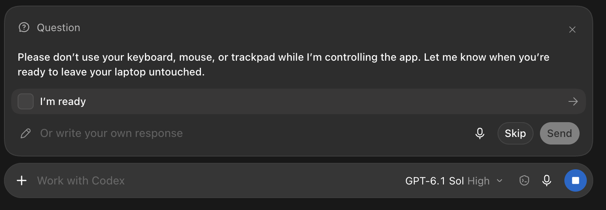

# What is MCP and why might we need it?

## MCP in brief

MCP (Model Context Protocol) standardizes how AI applications connect to external tools and data. An agent can use an MCP server to fetch a weather forecast, read documentation, or edit a document. The host application manages the connection and tool execution; the model selects tools and supplies arguments. See the [MCP architecture overview](https://modelcontextprotocol.io/docs/2026-07-28/learn/architecture).

In this article, we use MCP to let an agent edit 3D models in a Flutter CAD app.

## When should we add MCP to a Flutter app?

For a mobile news client, a backend MCP server is usually a simpler way to expose articles and search. An app-level server becomes useful when the agent needs local state or functionality available only inside the app. The decision depends on where the required data and operations live.

Desktop editors such as Figma, AutoCAD, Photoshop, and Final Cut Pro are natural candidates. Their workflows contain repeated operations on structured documents. Exposing those operations lets an agent work without reproducing every mouse and keyboard action.

## Why does my CAD app need MCP?

The expected benefits are:

- **Less visual interpretation.** The agent can read feature IDs, dimensions, and parameters as JSON instead of inferring them from screenshots. Compact responses may reduce token use, but large tool descriptions and results also consume context. Savings require measurement.
- **No dependency on window focus.** Tool calls can edit the document without moving the pointer or bringing the app to the foreground. The app must still prevent conflicting edits from the user and agent.
- **Discoverable operations.** MCP exposes tool names, descriptions, and argument schemas through `tools/list`. This documents the operations the server actually exposes. UI features still need explicit MCP handlers. See the [tools specification](https://modelcontextprotocol.io/specification/2025-11-25/server/tools).
- **Direct model access.** The agent can address features by ID and pass dimensions directly, avoiding camera movement and repeated selection. This depends on the tools provided; MCP does not add CAD operations by itself.

Computer use can also occupy the user's input devices. In the example below, the agent asks the user to leave the computer untouched:



These benefits can reduce interaction overhead. They do not establish that MCP is faster or cheaper for every task. Screenshots remain useful for checking the result.

Even when an agent can operate the UI, MCP may be a useful optimization. Keeping document operations separate from widgets makes both automation and testing easier.

# How can we implement MCP in Dart/Flutter?

## Available packages

These are three relevant options, checked on 20 October 2026. Transport and compatibility information below comes from the package documentation; it is not an independent conformance assessment.

| Package | Version | Scope and transports | Main consideration | License |
| --- | --- | --- | --- | --- |
| [`dart_mcp`](https://pub.dev/packages/dart_mcp) | 0.5.2 | Client and server APIs; built-in stdio and custom stream channels. | Maintained in `dart-lang/ai`. Marked experimental; Streamable HTTP and authorization are not built in. | BSD-3-Clause |
| [`mcp_dart`](https://pub.dev/packages/mcp_dart) | 2.4.3 | Client and server APIs; stdio, Streamable HTTP, and custom transports. | Documents support for both 2026-07-28 and earlier protocol revisions, with authentication hooks. | MIT |
| [`mcp_server`](https://pub.dev/packages/mcp_server) | 3.0.0 | Server package; stdio, Streamable HTTP, and legacy SSE. | Server-focused alternative; documents support through 2026-07-28 and requires `dart:io`. | MIT |

For a local stdio integration, `dart_mcp` is worth evaluating. For Streamable HTTP or support spanning the newer and older protocol revisions, `mcp_dart` offers more of that infrastructure directly. Check the specific release, supported clients, issue history, and examples before adopting either.

The [Dart and Flutter MCP server](https://docs.flutter.dev/ai/get-started#how-flutter-ai-plugins-work) serves a different purpose: it exposes development tools such as analysis, tests, and runtime inspection. Our CAD server needs application-specific modeling tools.

## Writing from scratch

An AI agent can generate an adapter, but generated code still needs review and tests. The protocol specification remains the contract.

| Question | SDK | Custom adapter |
| --- | --- | --- |
| Who handles protocol messages and lifecycle? | The SDK, within its supported scope. | The app team. |
| Who implements CAD operations? | The app team. | The app team. |
| Who tracks protocol changes? | SDK maintainers provide updates; the app team evaluates and adopts them. | The app team implements and tests them. |
| How much control do we have? | Public APIs, extensions, or a maintained fork. | Direct control over all adapter code. |
| What must we test? | App behavior and integration, plus unsupported SDK behavior. | App behavior, integration, and the protocol implementation. |

An SDK is the better default for a new production integration. It reduces the protocol code we must maintain. A custom adapter can suit a limited experiment with a fixed transport, protocol revision, and tool set.

For either approach, inspect maintenance activity, license terms, implementation quality, extension points, and migration cost. AI-generated code does not remove dependency or licensing review.

## Which approach will we use in the CAD app?

For this article, we use the app's [existing custom adapter and bridge](https://github.com/mishkov/faust_cad_app_2/tree/3b473595f128766e386ccfd543f73780542fccba). It already connects to the running document, uses stdio, and adds no MCP package dependency. This keeps the example tied to code we can inspect.

The choice is specific to this demonstration. For a new production version, I would start with an SDK for the protocol layer and retain the app-specific bridge and controllers. `dart_mcp` covers the local stdio shape; `mcp_dart` is the stronger candidate when newer protocol support or Streamable HTTP is required.

The current adapter targets the initialization-based **2025-11-25** protocol and exposes tools. The latest published revision checked for this article is **2026-07-28**, which replaces that handshake with per-request version and capability metadata. Extending compatibility requires additional implementation and testing. See [versioning and compatibility](https://modelcontextprotocol.io/specification/2026-07-28/basic/versioning).

# Implementing MCP in the CAD app

## Connect the agent to the running app

The implementation has two connections:

```text
Agent host -> stdio MCP adapter -> local WebSocket bridge -> CAD controllers
```

The host launches `bin/faust_mcp.dart` as a subprocess. The adapter reads newline-delimited JSON-RPC messages from stdin and writes responses to stdout. Logs go to stderr, as required by the [stdio transport specification](https://modelcontextprotocol.io/specification/2025-11-25/basic/transports).

The desktop app runs the bridge on `127.0.0.1`. Connections require a generated token; browser Origin headers are rejected. The WebSocket connection is an internal app bridge. The MCP client uses stdio.

The bridge starts when the user enables MCP in Settings. The app must remain running while the agent uses it.

## Define tools and their arguments

The tool definitions live in `lib/automation/automation_tools.dart`. Each includes a name, description, and JSON Schema for its arguments.

| Tools | Purpose |
| --- | --- |
| `cad_get_document`, `cad_get_profiles` | Inspect features, revisions, and available sketch regions. |
| `cad_begin`, `cad_finish` | Acquire and release exclusive editing control. |
| `cad_set_sketch` | Create or update points, segments, and circles on a principal plane. |
| `cad_extrude`, `cad_set_extrusion` | Create a linked extrusion or change its distance and direction. |
| `cad_delete_feature`, `cad_undo`, `cad_redo` | Delete a feature or navigate edit history. |
| `cad_render` | Render document bodies with an independent camera. |

Document lengths are millimeters; camera angles are degrees. Descriptions also explain profile selection, revision requirements, and retry behavior. The server validates arguments before applying operations.

The current interface supplies numeric sketch geometry. Editing sketch constraints through MCP is outside its scope. Tool coverage must be explicit; adding a UI feature does not automatically expose it.

## Handle MCP messages

For the adapter's target revision, the main sequence is:

1. `initialize`: exchange server information, the supported revision, and capabilities.
2. `notifications/initialized`: mark the client ready.
3. `tools/list`: return tool definitions.
4. `tools/call`: validate arguments and dispatch a tool.

The adapter also handles `ping`. This sequence follows the [2025-11-25 lifecycle](https://modelcontextprotocol.io/specification/2025-11-25/basic/lifecycle). A custom implementation must also handle malformed requests, unknown methods, disconnects, and timeouts. An SDK takes over much of this protocol work; it does not implement the CAD commands.

## Apply edits through the document controller

The automation controller uses the document command layer rather than manipulating widgets. Each mutation supplies:

- `sessionId`: the current editing session.
- `expectedRevision`: the document version the command was prepared against.
- `requestId`: an application-level identifier used to detect retries.

The server evaluates a draft before publishing it. Failed operations preserve the previous model and history. Each successful modeling change becomes an undo step.

While the agent owns editing control, human document mutations are blocked. Camera movement and inspection remain available. **Stop AI** revokes the session and prevents an unfinished draft from being published. Disconnects and an idle timeout release the lock.

After a lost response, the client retries with the same application `requestId` and arguments. Within the active session's receipt limit, this returns the stored result instead of repeating the edit. This identifier is separate from the JSON-RPC message ID. After losing the session, inspect the document before issuing new commands.

For a washer, the workflow is: begin editing, create two concentric circles, read the current profiles, select the region containing the hole, extrude it, inspect the result, and finish editing. Profile IDs belong to a particular document revision and must be refreshed after relevant changes.

## Configure the client

Open **Settings → AI Integration**, enable MCP, and use **Copy MCP connection**. Supply that endpoint to the adapter:

```json
{
  "mcpServers": {
    "faust-cad": {
      "command": "/absolute/path/to/dart",
      "args": ["run", "/absolute/path/to/faust_cad_app_2/bin/faust_mcp.dart"],
      "env": {
        "FAUST_CAD_ENDPOINT": "ws://127.0.0.1:47831/COPIED_CONNECTION_TOKEN"
      }
    }
  }
}
```

Replace the paths and endpoint. This is an example configuration shape; use the format required by the chosen MCP client. The endpoint contains a secret and should not appear in published logs.

## Testing

Test the protocol integration and CAD behavior separately:

- **Protocol and transport:** initialization, tool discovery and calls, invalid arguments, clean shutdown, and rejected bridge connections.
- **Document behavior:** dimensions and holes, undo/redo, failed edits preserving state, stale revisions, duplicate requests, and competing editors.
- **User control:** visible editing state, Stop AI during an operation, disconnect recovery, and continued camera interaction.

The [existing automation tests](https://github.com/mishkov/faust_cad_app_2/tree/3b473595f128766e386ccfd543f73780542fccba/test/automation) cover these areas, including a real stdio subprocess and a washer extrusion. They provide regression coverage, not a complete protocol conformance result.

Use the [MCP Inspector](https://modelcontextprotocol.io/docs/2026-07-28/tools/inspector) to inspect schemas and call tools without involving a model. Then test with the intended agent client. A successful Inspector session alone does not establish agent reliability or performance.

For the later computer-use comparison, define identical modeling tasks and correctness criteria. Reset the document and start a fresh agent session for each run. Keep the model, settings, and starting instructions consistent; document the available tools. Alternate execution order and repeat each task. Record completion time, success, retries, human intervention, token counts, and any reported cache use. Alternating order alone does not control caching. Compare correct results and report failures as well as successful runs.

# Measure profit
