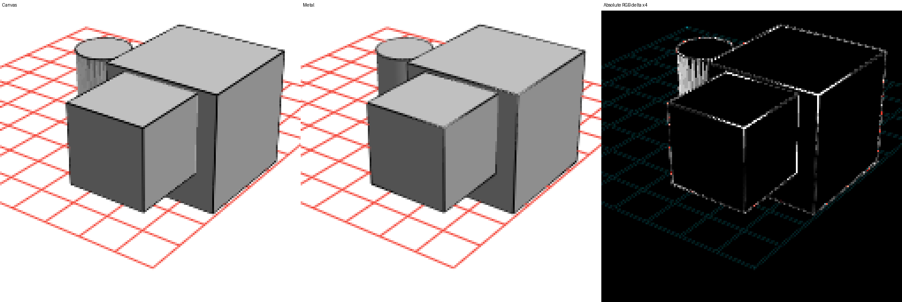
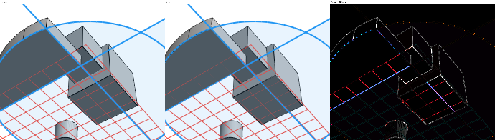
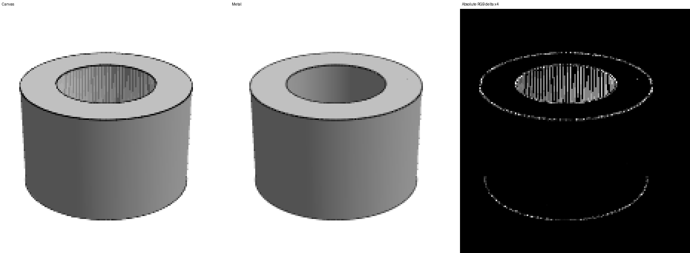

# Native Metal viewport

Select it explicitly:

```sh
flutter run -d macos --dart-define=CAD_RENDER_BACKEND=metal
```

`CadScene(backend: CadRenderBackend.metal, ...)` selects it per viewport. Canvas
remains the default and reference. Selecting Metal never invokes a Canvas scene
renderer, including when the device, shader compilation, or a command fails.
Failures display a diagnostic. Flutter continues to render controls and the
separate active sketch editor.

## Implementation and ownership

The renderer is an AppKit `MTKView` embedded using Flutter's `AppKitView`.
Core Animation owns presentation drawables. This avoids the Flutter GPU wrapper
allocation/lifetime problem in the earlier prototype, without copying pixels to
Dart or modifying the Flutter engine.

- Geometry is uploaded once per tessellated scene/sketch revision. Camera updates
  carry the camera, viewport, and selection; no CPU visibility masks are built.
- Indexed world-space positions use high/low float pairs. Exact double positions
  are retained for close views. Normals, face IDs, boundaries and sketch geometry
  are persistent native buffers. Shared CAD boundaries are deduplicated; triangle
  diagonals and cylindrical patch seams are not outlines.
- A positive camera-space Y is forward. Projection uses infinite reverse Z with
  `depth32Float`, clear depth zero and `greaterEqual` testing. The geometric
  near plane is `1e-6`. When all conservative scene bounds are in front, half
  the nearest bound scales reverse Z to use the useful depth range. This clips
  only empty space and reduces precision loss from an extremely small fixed
  depth scale. Crossing views use the physical near value.
  Both sides of each face render. Lighting and planar selection colors follow
  the reference renderer.
- Bounds crossing/approaching the near plane select double-precision triangle
  clipping to the five frustum planes. Those vertices still use Metal shading,
  depth testing and rasterization. This prevents float clipper cancellation in
  inside/near views; it adds CPU work in such views.
- CAD boundaries and standalone lines use depth testing without writes. A
  relative depth bias of `2^-20` handles numerical ties. Sketch fills also use
  a slope-scaled depth bias of one to stabilize MSAA coverage on support faces;
  they never write depth. Wireframe
  draws all CAD boundaries red; sketches still use solid occlusion through a
  depth-only body pass.
- Bodies use the highest supported MSAA count among 8, 4 and 1. M1 selects 4.
  Screen-space line quads use analytic coverage, butt caps, logical pixel widths,
  and premultiplied blending. A fractional physical viewport preserves framing
  at noninteger DPR even though target dimensions must be integral.
- Two reusable frame slots bound GPU work; the layer allows three drawables.
  A busy renderer keeps only the latest camera request. Dart also coalesces
  requests while one platform call is outstanding. No lifetime allocation limit
  stops rendering. Static viewports do not continuously submit GPU commands.
- MetalKit recreates depth/MSAA targets when size or DPR changes. Replaced model
  buffers are released after commands using them finish. Per-frame clipping and
  selection buffers are cleared on model replacement. Disposing the Dart view,
  or destroying its native view during hot restart, removes the renderer and
  releases owned resources. In-flight commands retain their resources until
  completion.
- `capture()` is an explicitly requested offscreen BGRA readback for tests/export.
  It owns separate targets and allows one capture at a time. Normal presentation
  never reads pixels back.

Shaders ship as a bundled source resource and compile through
`MTLDevice.makeLibrary` when a renderer is created. This uses the system Metal
compiler, so installing Xcode's optional offline Metal Toolchain is unnecessary.
Compilation is outside warmed measurements; startup includes that cost.

## Validation

Tested on Apple M1, macOS 26.6.2, Flutter 3.47.5 / Dart 3.13.4, native Impeller.
Intel Macs and other GPUs have not been validated. The application deployment
target remains macOS 12; the Flutter SDK must support `AppKitView`. Other
platforms display the unsupported-backend error when Metal is explicitly selected.

The native suite compares the current Canvas renderer against Metal at nine
camera angles, DPR 1/1.5/2, changing viewport dimensions, planar selection,
reversed object order, hollow tubes, enclosed cavities, inside and near-plane
views, and wireframe. It also checks Flutter controls, dragging, zero-size hiding,
resizing, and six attach/dispose cycles. Existing reference tests retain their
original tolerances. The Metal suite reports exact pixel deltas separately from
its gross-regression guard (mean absolute channel delta below 0.65/255).

```sh
flutter test
flutter analyze
flutter drive --profile -d macos --enable-impeller \
  --driver=test_driver/metal_viewport_test.dart \
  --target=integration_test/metal_viewport_test.dart \
  --dart-define=METAL_CHECK_IMAGES=true
```

The driver writes `build/metal_report.json` and image pairs under
`build/metal_images/`. Pixel comparisons are offscreen and excluded from timing.
Use the image comparisons for raster quality; Flutter screenshot capture does
not reliably include an embedded native layer.

For the paired benchmark and a three-minute continuous orbit, use the separate
live timing target (do not combine timing and offscreen image capture):

```sh
flutter drive --profile -d macos --enable-impeller \
  --driver=test_driver/metal_viewport_test.dart \
  --target=integration_test/metal_performance_test.dart \
  --dart-define=METAL_SOAK=true
```

Keep the app foreground on an unlocked desktop throughout capture. The harness
checks this for every measured phase. It uses the existing default/partial
extrusion fixtures, camera paths and Canvas profile painter, with identical
viewport and DPR for each backend. Each path warms for four seconds and captures
six seconds of real vsync, followed by a timing flush.

If app activation fails in an automated desktop session, add
`--dart-define=VIEWPORT_WAIT_FOR_FOCUS=true`. Bring the window forward when
`VIEWPORT_FOCUS_READY` appears, then invoke `ext.cad.startBenchmark` on the printed
VM service URI with its isolate ID. The focus page is mounted before tests begin so
native pointer events have a valid test view. Avoid accessibility inspection
while the test is capturing.

GPU completion time comes from the native command buffer. Delivered cadence is
counted from distinct camera serials in `CAMetalDrawable` presentation callbacks,
filtered to the native measurement interval. Flutter frame counts are reported
separately and must not be interpreted as fresh Metal frames. Native request to
presentation latency starts after the platform message state is applied; it
excludes Dart packing/transport and native revision preparation, and is not total
input latency. GPU time excludes compositor
work and waiting for presentation.

## Results

Measured results and enlarged boundary examples are recorded below. Metal's MSAA
and analytic stroke coverage differ from Canvas antialiasing. These are measured
visual differences, not pixel-identical output. This remains an explicitly
selected backend while migration quality and presentation pacing are evaluated.

Generate machine-readable summaries and nearest-neighbor 4x crops from actual
image pairs with `python3 tool/summarize_metal_viewport.py build/metal_report.json
--images build/metal_images --output build/metal_summary` (Pillow is needed for
image crops).

The final matrix passes **171 comparisons**, plus a direct interior-coverage
assertion for coplanar sketch fill (at least 99% of known uniform reference pixels
must retain their overlay color). Native button/text/drag input, zero-size hiding,
resizing and all six disposal cycles pass. All **518** Dart tests pass; static
analysis is clean.

| Scene | Cases | Largest mean absolute RGB delta / 255 | Largest pixels over delta 4 |
| --- | ---: | ---: | ---: |
| default | 27 | 0.181 | 1.829% |
| partial | 27 | 0.383 | 1.870% |
| inside | 3 | 0.073 | 0.185% |
| near | 3 | 0.089 | 0.241% |
| selection | 27 | 0.248 | 2.010% |
| holes | 27 | 0.211 | 0.724% |
| cavity | 3 | 0.073 | 0.185% |
| reverse | 27 | 0.244 | 2.005% |
| wireframe | 27 | 0.486 | 2.649% |

Exact per-case values are in [the native image report](performance/metal_viewport_images_macos.json).
Below, each actual crop is enlarged 4x with nearest-neighbor sampling. Columns
are Canvas, Metal, and absolute RGB difference amplified 4x. The blue coplanar
fill stays uniform; remaining differences include MSAA silhouettes, stroke
coverage, and one-channel blend rounding. Boundary pixels can differ by up to
255, so averages alone should not be treated as proof of image equivalence.





## Controlled profile results

Apple M1; **912 x 602 logical pixels, DPR 1**, identical sidebar/viewport for both
backends. Every capture passed foreground-PID and unlocked-desktop checks. Native
presentation counts (not Flutter's approximately 144 framework frames/second)
show the delivered camera cadence:

| Scene / path | Canvas FPS | Metal fresh FPS | Metal UI p95 ms | Metal raster p95 ms | Native GPU p95 ms | Native request-to-present p95 ms |
| --- | ---: | ---: | ---: | ---: | ---: | ---: |
| default / orbit | 39.58 | 59.96 | 0.878 | 0.833 | 3.130 | 33.50 |
| default / pan | 39.16 | 59.98 | 0.875 | 0.862 | 2.994 | 33.49 |
| default / zoom | 38.32 | 60.15 | 0.873 | 0.846 | 2.940 | 27.26 |
| partial / orbit | 26.82 | 60.14 | 0.898 | 0.814 | 2.832 | 33.38 |
| partial / pan | 26.82 | 60.14 | 0.927 | 0.859 | 3.217 | 33.12 |
| partial / zoom | 27.08 | 59.97 | 0.895 | 0.841 | 3.372 | 27.27 |

The [frame report](performance/metal_viewport_frames_macos.json) includes p50,
p95 and p99, presentation interval percentiles, submission counts, and memory
snapshots. Metal retained one geometry upload through all three camera paths per
scene, and used no more than two frame slots. Native GPU p99 stayed below 5.7 ms;
UI/raster p99 stayed around 1 ms. These fixtures meet the 60 FPS target with
processing headroom. Presentation latency remains about 20 ms median and up to
34 ms at p95/p99, so frame cadence should not be confused with input latency.

An earlier completed three-minute continuous orbit on this bounded ownership
path delivered **10,773 additional distinct frames** without renderer errors or
an allocation-budget stop. Reported total Metal allocation stayed at **167.45
MiB**; resident memory moved from **161.48 to 114.17 MiB**, with normal variation.
Scene buffers stayed at **235,392 bytes** and frame scratch at **256–512 bytes**.
Total Metal allocation includes Flutter/driver resources, not only this backend.
Final depth/overlay tuning followed that soak; the final revision separately
passes the full image and six-cycle disposal tests. The report preserves this
lineage instead of treating the old soak as a new final-revision measurement.

Recommendation: continue migration with the selectable native backend. It
removes the CPU visibility bottleneck and the previous short-lived surface pool,
while maintaining a bounded resource lifetime. Keep Canvas as the default
reference until broader hardware coverage, remaining AA differences and native
presentation latency have been reviewed. This is evidence for the representative
fixtures, not a guarantee for arbitrary assemblies or all close-view workloads.

The normal debug app was also checked with real mouse face selection. Both hot
reload and hot restart succeeded through the Dart tooling connection, with no
runtime errors after either operation. The native presentation layer explicitly
uses the sRGB color space for display color matching.
